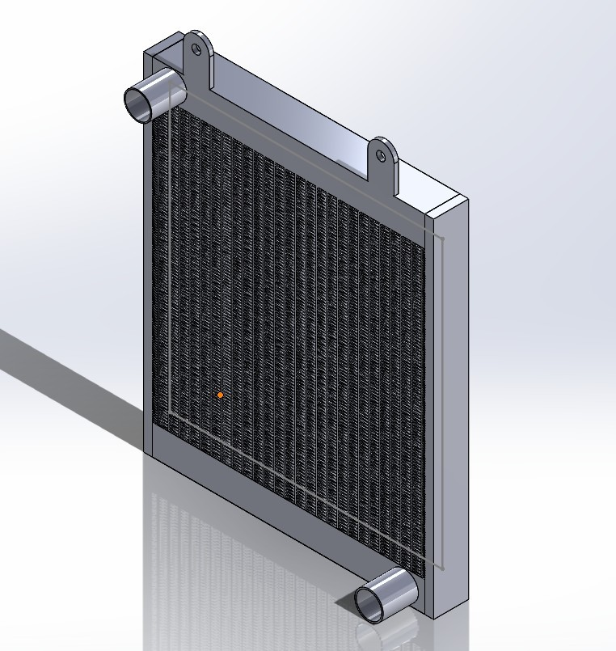
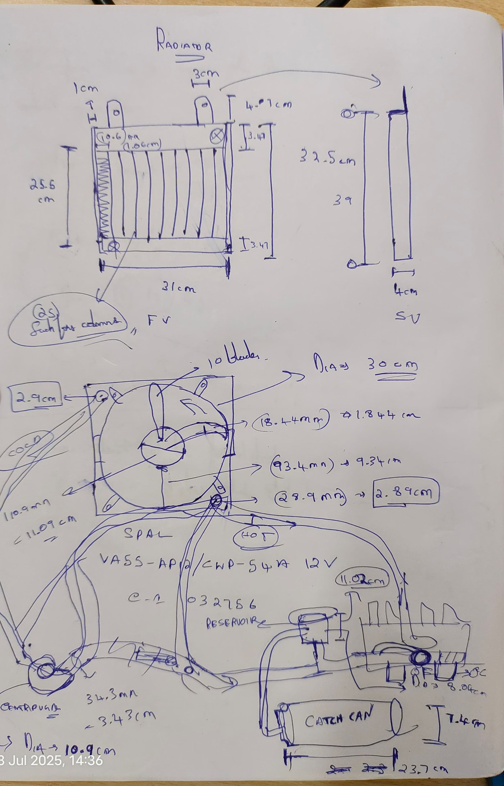
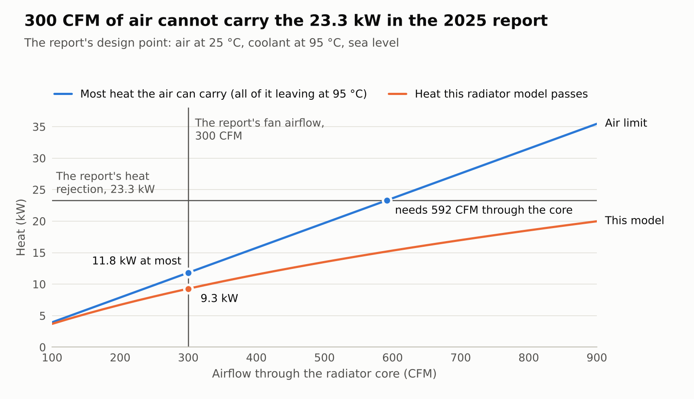
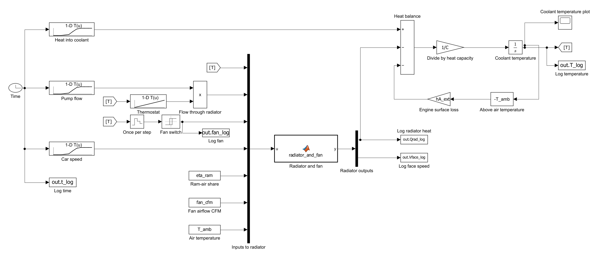
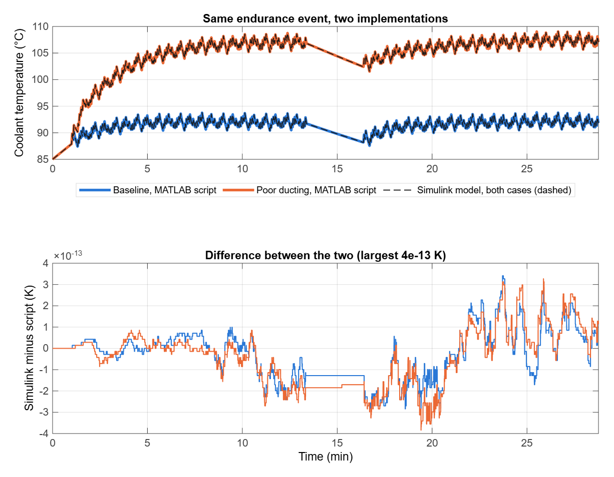
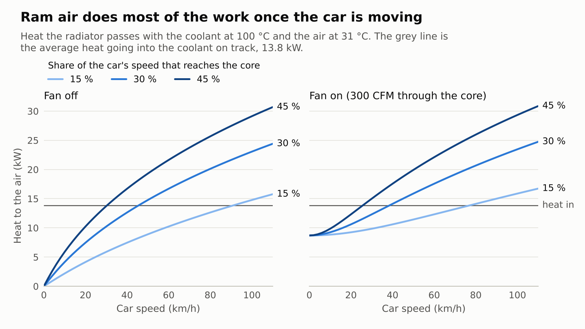
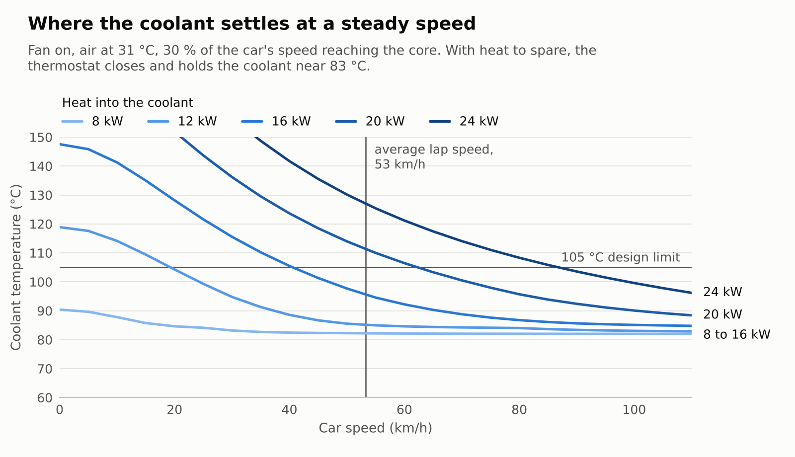
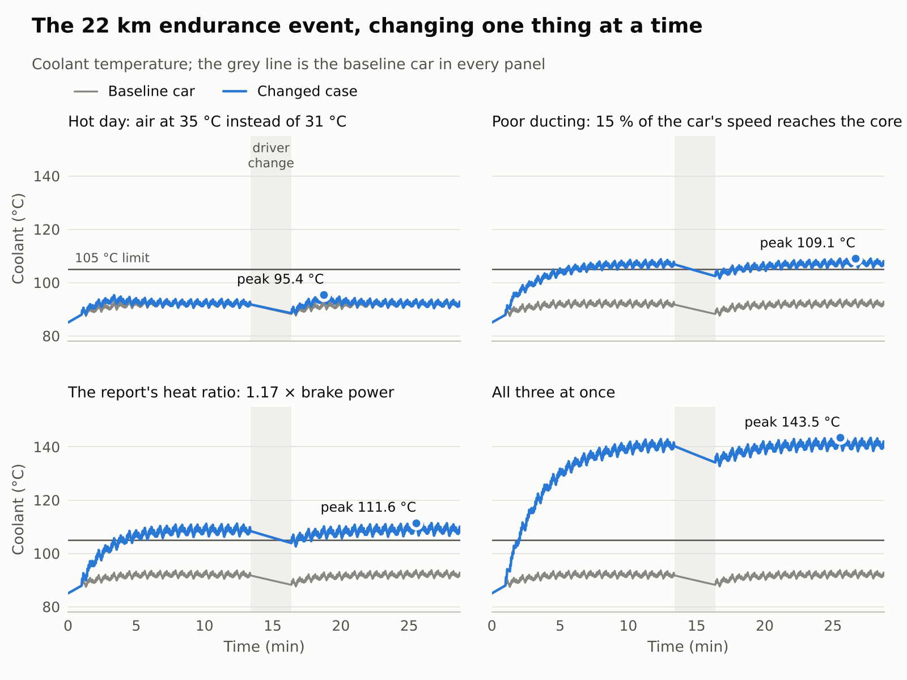
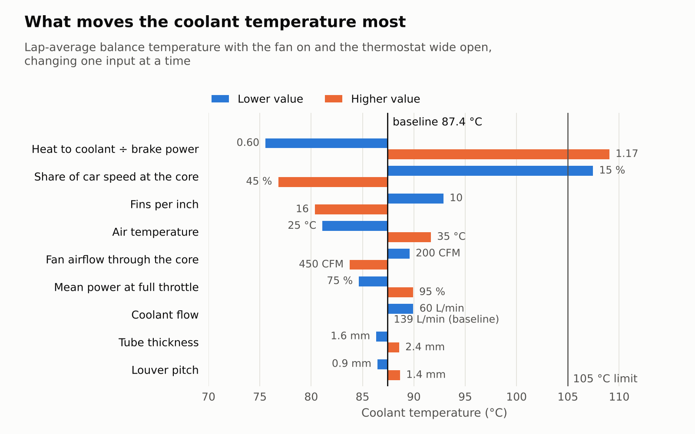
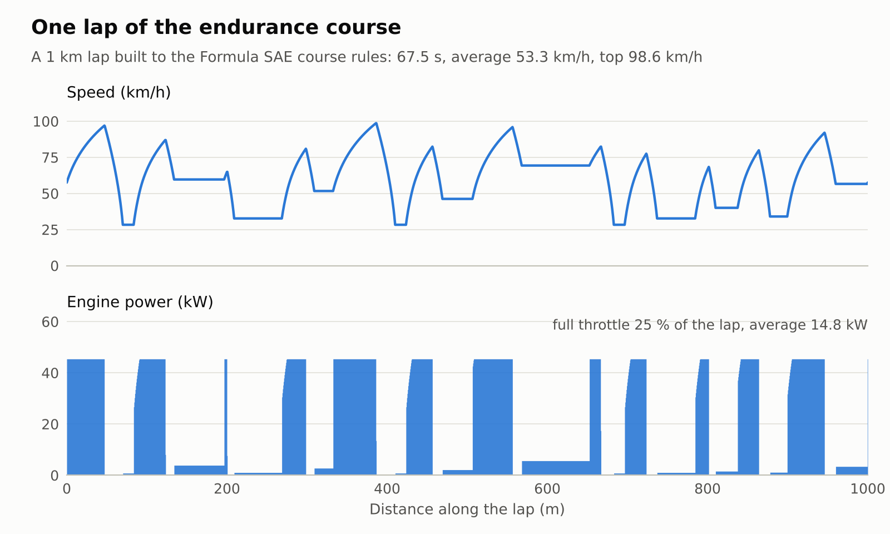

# Formula Student radiator: sizing check and Simulink cooling model

Engine cooling for Ashwa Racing, RVCE's Formula Student team. This repository checks the radiator I measured, modelled and sized in 2025, and models the coolant loop through the 22 km endurance event in MATLAB, with the Simulink version of the model generated entirely by script.

<p align="center">
  
  &nbsp;&nbsp;
  
</p>
<p align="center"><sub>The radiator in SolidWorks, and my measurement sketch of the cooling parts on the car (23 July 2025).</sub></p>

## In short

- **The radiator is big enough, provided the duct works.** On a 22 km endurance run over a lap built to the Formula SAE course rules, with 31 °C air (Coimbatore in January), the coolant peaks at 93.9 °C and the fan never has to switch on.
- **The duct and the engine's heat split decide it.** If 15 % of the car's speed reaches the core instead of 30 %, the radiator can only balance the heat at 107 °C, above the 105 °C limit. If the engine puts 1.17 times its brake power into the coolant (the figure in my 2025 report) instead of 0.8 times, it balances at 109 °C.
- **My 2025 report reached the right conclusion with the wrong numbers.** 300 CFM of air can carry at most 11.8 kW from 95 °C coolant, about half the 23.3 kW the report credited the radiator with. The main errors: full engine power treated as continuous, tube size taken from the core depth, and a log-mean temperature difference that held the air at 25 °C.
- **The Simulink model is built by code.** `build_cooling_model.m` places all 29 blocks and draws all 31 connections, and `check_simulink.m` compares the model with the plain MATLAB version at all 17,261 time steps of the event. In MATLAB R2026b the two agree to within 4 × 10⁻¹³ K. A separate Python version of the model reproduces every result.

## How it went

In mid-2025, ahead of the team's Formula Bharat season, I was responsible for the engine cooling calculation in Ashwa Racing's engine subsystem (Suzuki GSX-R600 engine). I measured the radiator, fan, pump and catch can on the car, modelled the radiator in SolidWorks, and wrote a heat-rejection report: [original/engine-cooling-report-2025.pdf](original/engine-cooling-report-2025.pdf).

I wanted to go further, with a conjugate CFD analysis of the core and a Simulink model of the whole loop, but neither came together then: both were more than I could set up at the time.

In 2026 I came back to it and rebuilt the analysis as code: every input in one file with its source, a radiator model from standard correlations, a lap and an endurance event built to the rules, and a Simulink model generated by a script and checked against the plain MATLAB version. Working through the old report line by line also showed where it went wrong.

## The 2025 report, checked

`report_check.m` recomputes the report from its own inputs. Thirteen of its 19 printed numbers come back to within 0.02 %. The other six all follow from one arithmetic slip in the air-side coefficient. The physics is where it goes wrong:

| Step | What the report did | What holds |
|---|---|---|
| Heat into the coolant | 35 % of the fuel power at peak power, 59.6 kW, as a continuous load | Over an endurance lap the engine averages 14.8 kW of brake power and is at full throttle 25 % of the time, so the coolant takes about 11 to 19 kW on average, depending on the engine's heat split. 59.6 kW is 1.17 times brake power; the model assumes 0.8 and tests 0.6 to 1.17. |
| Coolant temperatures | 95 °C in, 80 °C out, at 139 L/min | A 15 K drop at that flow is 145 kW. 59.6 kW would cool the coolant by 6.1 K. |
| Tube size | 36 × 40 mm inside each tube | 40 mm is the core depth; the tubes are flat and about 2 mm thick. The coolant runs about 26 times faster than the report assumed (1.7 m/s, Re ≈ 15,000), and the coolant-side coefficient is about 16,000 W/m²K, not 684. |
| Air-side coefficient | 35 × 2.985<sup>0.78</sup> = 95.7 W/m²K | The arithmetic gives 82.1. The louvered-fin correlation of Chang and Wang gives 107 at this airflow. |
| Fin efficiency | 0.98 | Calculated, then left out of the overall coefficient (a small effect). |
| Air-side area | 9.00 m², estimated | The geometry gives 2.68 m²: 2.16 m² of fins and 0.51 m² of tube. |
| Heat rejected | 23.3 kW, from U·A·ΔT<sub>lm</sub> with the air at 25 °C at both ends | 300 CFM through the core can carry at most 11.8 kW, even if all of it left at 95 °C. Carrying 23.3 kW would heat the air by 138 K, above the coolant temperature. The report's own U·A gives 10.5 kW by the effectiveness-NTU method; this model gives 9.3 kW. |
| Conclusion | Airflow is the limit: duct, seal and shroud the radiator, and keep air moving when the car is stopped | Holds. By the report's own numbers the coolant side was the larger resistance; with the right tube size the air side clearly dominates. |

<picture>
  <source media="(prefers-color-scheme: dark)" srcset="figures/report-vs-air-limit-dark.png">
  
</picture>

## The model

The coolant and the engine metal around it are treated as one thermal mass *C*:

$$C\frac{dT}{dt} = \dot Q_{in}(t) - \dot Q_{rad}(T, \dot m_{rad}, V_{face}) - hA_{ext}(T - T_{amb})$$

- **Heat in.** $\dot Q_{in} = \dot Q_{idle} + r\,P_b(t)$. The brake power $P_b(t)$ comes from a point-mass lap simulation: power- or traction-limited acceleration, grip-limited corners and braking. *r* = 0.8 is the share of brake power that ends up in the coolant.
- **Radiator.** Effectiveness-NTU for a crossflow core with both fluids unmixed. Air side: louvered fins, with the Chang and Wang (1997) j-factor and fin efficiency. Coolant side: Gnielinski in turbulent flow, Shah and London in laminar flow, blended between the two. Water properties follow the coolant temperature.
- **Air through the core.** $V_{face}^2 = (\text{fan} \cdot V_{fan})^2 + (\eta_{ram} v_{car})^2$, where $\eta_{ram}$ = 0.30 is the share of the car's speed that reaches the core and the fan moves 300 CFM through it.
- **Thermostat and fan.** The thermostat opens linearly from 82 °C and is fully open at 95 °C (GSX-R600 specification), passing 2 % of the flow when shut. The fan switches on at 95 °C and off at 90 °C.
- **Event.** 60 s idling on the grid, 11 laps, a 3-minute driver change with the engine off, then 11 more laps: 22 km in 28.8 minutes, as in Formula SAE rule D.12.
- **Solver.** Classical fourth-order Runge–Kutta at a fixed 0.1 s step, the same in the MATLAB script and in Simulink.

Every input is in [`matlab/cooling_params.m`](matlab/cooling_params.m), tagged with where it comes from: the sketch, the dyno, the 2025 report, a named source, or an engineering assumption. The equations and the full list of inputs are in [docs/model.md](docs/model.md).

### The Simulink model

`build_cooling_model.m` creates `simulink/cooling_loop.slx` block by block:

- the drive cycle enters as lookup tables;
- the thermostat is a lookup, and the fan is a relay sampled once per step;
- the radiator and fan are a MATLAB Function block;
- the heat balance feeds an integrator.

The radiator block calls the same `radiator_block.m` as the scripts, so the two versions cannot drift apart. The coolant temperature reaches the blocks that need it through a Goto/From tag, and every block parameter is a named variable in the model workspace.

<p align="center"></p>

`check_simulink.m` runs the model over the whole event twice: once for the baseline car, and once with poor ducting so that the fan has to switch on. Each run is compared with `simulate_cooling.m` step by step. In MATLAB R2026b the largest temperature difference is 3.8 × 10⁻¹³ K and the largest difference in radiator heat is 1.6 × 10⁻¹⁰ W, both rounding error, and the fan switches on at the same step in both. The compiled model runs the 29-minute event in under a second; the script takes about 4.5 s.

If the MATLAB Function block cannot be compiled on a computer, `build_cooling_model.m` swaps in an Interpreted MATLAB Function block that runs the same code. `simulink/cooling_loop.slx` was saved in R2026b; in an older release, run `build_cooling_model` to recreate it.

<p align="center"></p>

## Results

### On track, ram air does most of the work

<picture>
  <source media="(prefers-color-scheme: dark)" srcset="figures/radiator-heat-vs-speed-dark.png">
  
</picture>

Standing still, the fan alone takes 8.7 kW out of 100 °C coolant. With 30 % of the car's speed reaching the core, the radiator passes more than the 13.8 kW the coolant takes in on average once the car is above about 40 km/h with the fan on, or 45 km/h with it off.

### Where the coolant settles

<picture>
  <source media="(prefers-color-scheme: dark)" srcset="figures/steady-temperature-dark.png">
  
</picture>

At the lap's average speed of 53 km/h the radiator balances 16 kW at 96 °C, but 20 kW only at 111 °C. When there is heat to spare, the thermostat closes and holds the coolant near 83 °C.

### The endurance event

<picture>
  <source media="(prefers-color-scheme: dark)" srcset="figures/endurance-dark.png">
  
</picture>

| Case | Peak in the event (°C) | Flat-out balance (°C) | Fan on | Above 105 °C |
|---|---:|---:|---:|---:|
| Baseline | 93.9 | 87.4 | never | never |
| Hot day, 35 °C air | 95.4 | 91.7 | 75 % of the event | never |
| Poor ducting, 15 % of car speed at the core | 109.1 | 107.4 | 94 % | 19 min |
| The report's heat ratio, 1.17 | 111.6 | 109.0 | 95 % | 24 min |
| All three together | 143.5 | 141.3 | 95 % | 27 min |

The flat-out balance is the lap-average temperature at which the radiator, with the fan on and the thermostat wide open, gets rid of all the heat (`lap_equilibrium.m`). It measures capacity. In the baseline the coolant runs warmer than that, near 92 °C, because the thermostat only needs to open three quarters of the way. The last case is far past boiling for water under a normal pressure cap, which a single-phase model does not cover: read it as "boils".

### What matters most

<picture>
  <source media="(prefers-color-scheme: dark)" srcset="figures/sensitivity-dark.png">
  
</picture>

Two inputs dominate, each moving the balance temperature by about 30 K across its plausible range: the share of brake power that reaches the coolant, and the share of the car's speed that reaches the core. Fin density comes third. 16 fins per inch instead of 12 would lower the balance by 7 K, though the model fixes the airflow and so ignores the extra pressure drop of denser fins.

### The lap

<picture>
  <source media="(prefers-color-scheme: dark)" srcset="figures/lap-dark.png">
  
</picture>

## What it means for the car

1. **Build the duct first.** With at least 30 % of the car's speed reaching the core, the coolant stays near 92 °C and the fan stays off. At 15 %, the car spends 19 of the event's 29 minutes above the limit.
2. **Measure the heat going into the coolant.** It is the largest unknown. Coolant temperatures into and out of the radiator, together with the pump flow, measured on the dyno or in a test run, give it directly (*Q* = *ṁ c*<sub>p</sub> Δ*T*).
3. **The fan is for the pits and the slow corners.** On track it adds little; standing still, it is all the cooling there is, about 8.7 kW from 100 °C coolant.

## Limits of the model

- One temperature for all of the coolant and the engine metal, with no delay around the loop.
- The airflow comes from two simple rules, a share of car speed and the fan's flow through the core, rather than a pressure balance with the core's resistance. The ram-air share is the least certain input.
- Heat into the coolant is a fixed share of brake power, not mapped against engine speed and load.
- Single-phase water: results above about 120 °C mean boiling.
- The tube thickness and the fin and louver dimensions are assumed until they are measured from the CAD.
- The lap is built to the rules, not taken from the actual track.

## Inputs

| Input | Value | Source |
|---|---|---|
| Core | 25 single-pass tubes at 10.6 mm pitch, 256 mm tall, 40 mm deep | sketch |
| Fins | 12 per inch, louvered | report; louver shape assumed |
| Tubes | 2.0 mm thick, 0.3 mm wall | assumed |
| Pump flow | 139 L/min | report |
| Engine | 71.62 hp (53.4 kW) peak at the clutch, at 10,610 rpm | team dyno run, 24 Dec 2024 |
| Mean power at full throttle | 85 % of peak | assumed |
| Heat into the coolant | 0.8 × brake power | assumed (report: 1.17) |
| Thermostat | starts to open at 82 °C, fully open at 95 °C | GSX-R600 specification |
| Fan | 300 CFM through the core (844 CFM in free air) | report; SPAL VA09-AP12/C-54A |
| Ram air | 30 % of car speed at the core | assumed |
| Air | 31 °C, 96.5 kPa | Coimbatore average January high; altitude |
| Car | 300 kg with driver, drag area 1.0 m², cornering grip 1.4 g | assumed |
| Heat capacity of coolant and engine | 30 kJ/K | assumed |

The full list is in [`matlab/cooling_params.m`](matlab/cooling_params.m) and [docs/model.md](docs/model.md).

## Run it

The Simulink part needs MATLAB with Simulink; it was tested in R2026b. Everything else runs in MATLAB or GNU Octave.

In MATLAB, from the `matlab` folder:

```matlab
check_everything   % eight groups of model checks, then builds, runs and checks the Simulink model
run_all            % recomputes everything in ../results
```

From the repository root, with Python 3, numpy and matplotlib:

```bash
octave --no-gui tests/export_params.m     # writes results/params.json (or run it in MATLAB)
python3 tests/check_against_python.py     # independent version of the model, compares every result
python3 python/make_figures.py            # redraws the figures from results/
```

## Layout

```
matlab/      the model, one function per file; the checks; the Simulink builder
simulink/    cooling_loop.slx, written by build_cooling_model.m
python/      reference.py (independent version of the model) and make_figures.py
tests/       check_against_python.py and export_params.m
results/     CSV output of run_all.m
figures/     the charts (light and dark versions) and the Simulink pictures
docs/        model.md: equations and every input
original/    the 2025 report, sketch, CAD views and dyno chart
cad/         the radiator in SolidWorks
```

## Credit

I made the radiator measurements, the CAD model and the 2025 report, and built this model, as part of Ashwa Racing's engine subsystem. The dyno run of 24 December 2024 is the team's. Everything here is shared with Ashwa Racing's permission.

## References

1. Y.-J. Chang and C.-C. Wang, "A generalized heat transfer correlation for louver fin geometry," *International Journal of Heat and Mass Transfer* 40(3), 533–544, 1997.
2. V. Gnielinski, "New equations for heat and mass transfer in turbulent pipe and channel flow," *International Chemical Engineering* 16(2), 359–368, 1976.
3. R. K. Shah and A. L. London, *Laminar Flow Forced Convection in Ducts*, Academic Press, 1978.
4. T. L. Bergman, A. S. Lavine, F. P. Incropera and D. P. DeWitt, *Fundamentals of Heat and Mass Transfer*, 7th ed., Wiley, 2011.
5. J. B. Heywood, *Internal Combustion Engine Fundamentals*, McGraw-Hill, 1988.
6. SAE International, *Formula SAE Rules 2024*, D.12 Endurance (course specifications, D.12.2).
7. SPAL VA09-AP12/C-54A: 11 in low-profile puller fan, 844 CFM free-air rating.
8. Climate normals for Coimbatore: average January high about 31 °C.

## License

The code is under the [MIT License](LICENSE). The report, sketch, CAD files and dyno chart in `original/` and `cad/` are shared with Ashwa Racing's permission and are not covered by that license.
